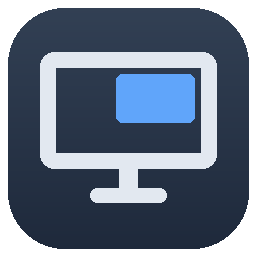
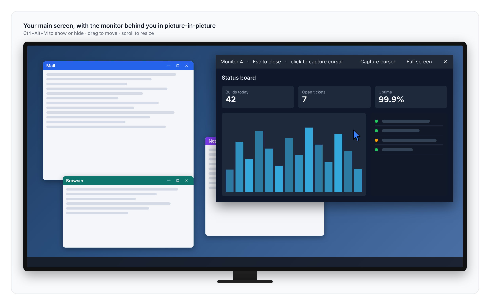
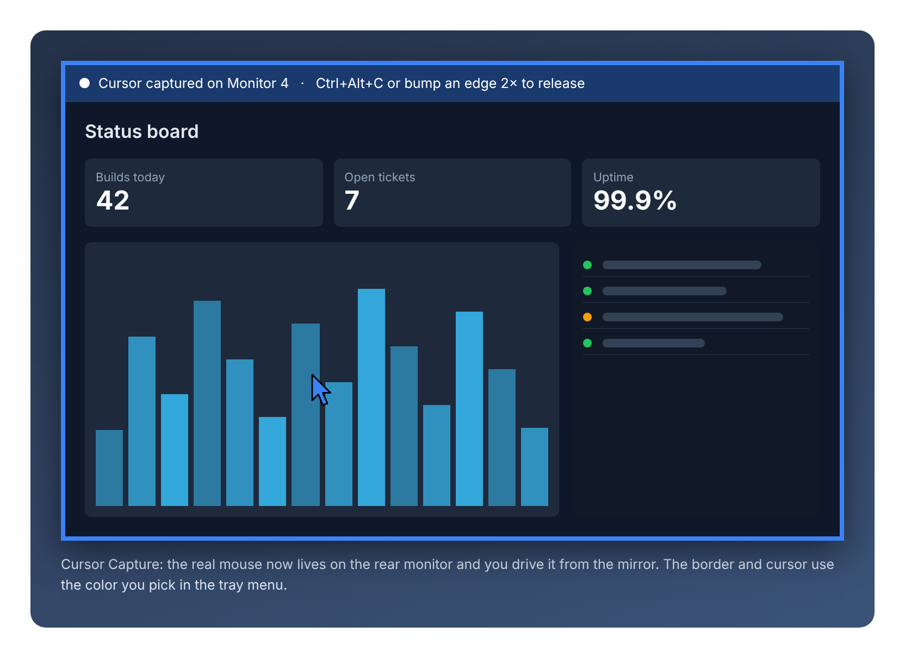
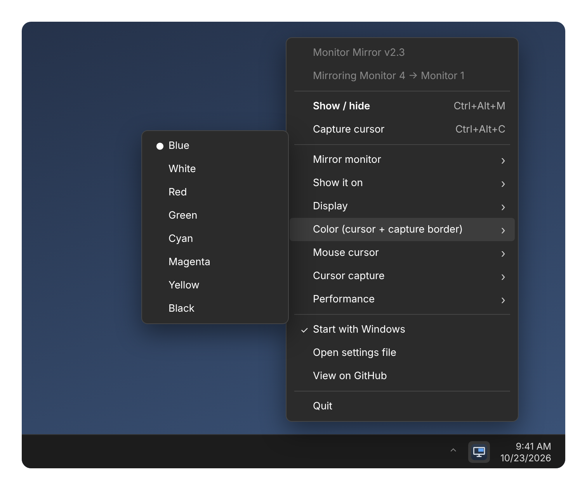

# Monitor Mirror

A Windows tray app that mirrors another monitor onto your main screen with a hotkey, so you can see the screen behind you without turning around.



<sub>Images in this README are illustrations, not screenshots.</sub>

## Features

- **Hotkey mirror.** Show a live copy of another monitor full-screen or picture-in-picture.
- **Live cursor.** Renders the real Windows cursor shape (arrow, I-beam, etc.) with optional color tinting.
- **Picture-in-picture.** Drag to move, scroll to resize.
- **Cursor Capture.** Control the real mouse on the mirrored monitor directly from the mirror. Release with a hotkey or by bumping a screen edge.
- **GPU capture.** Uses Desktop Duplication (dxcam) for smooth frame rates, with automatic GDI fallback.
- **Tray menu** for all settings, plus a *Start with Windows* toggle.
- **Auto-update takeover.** Starting a newer version closes the older running copy.
- **Survives sleep.** Re-detects monitors after sleep, wake, or a screen switching off, and keeps mirroring the right monitor even if Windows renumbers them. If the app ever crashes, it restarts itself.



## Hotkeys

| Hotkey | Action |
| --- | --- |
| `Ctrl+Alt+M` | Toggle the mirror on/off |
| `Ctrl+Alt+C` | Toggle Cursor Capture |
| `Esc` / click | Hide the mirror |

Left-click the tray icon to toggle the mirror; right-click for settings.



## Setup

Requires Windows 10/11 and Python 3.10+.

```powershell
pip install -r requirements.txt
```

Then double-click `mirror.pyw`. The `.pyw` extension runs it without a console window.

**Tip:** Run it from your cloned repo folder (e.g. `C:\Dev\MonitorMirror`) before turning on *Start with Windows*. The startup entry follows whichever copy you last opened, and updating is then just a `git pull`. If Windows has turned the entry off (Task Manager → Startup apps), the tray menu says so and one click turns it back on.

## Data

Everything lives in `%APPDATA%\MonitorMirror\`:

| File | What's in it |
|---|---|
| `settings.json` | Your settings |
| `mirror.log` | Startups, sleep/wake and display changes, handled errors |
| `crash.log` | Crashes and automatic restarts |

Tray → *Open log folder* opens it.

## License

GPL-3.0. See [LICENSE](LICENSE).
