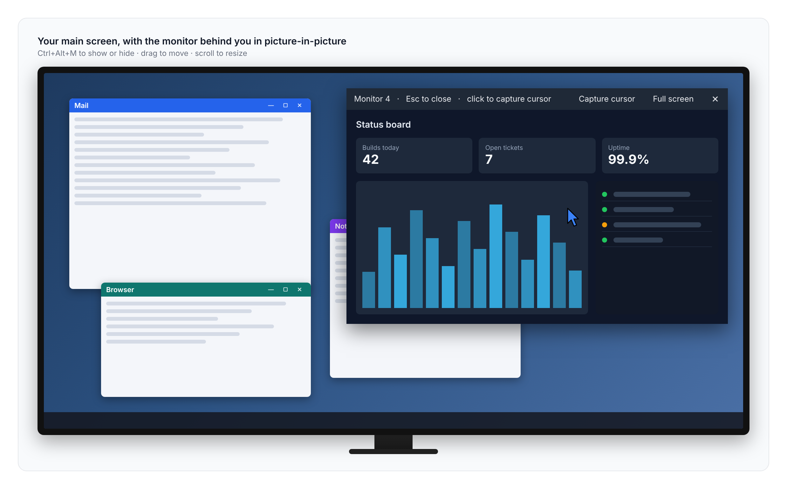
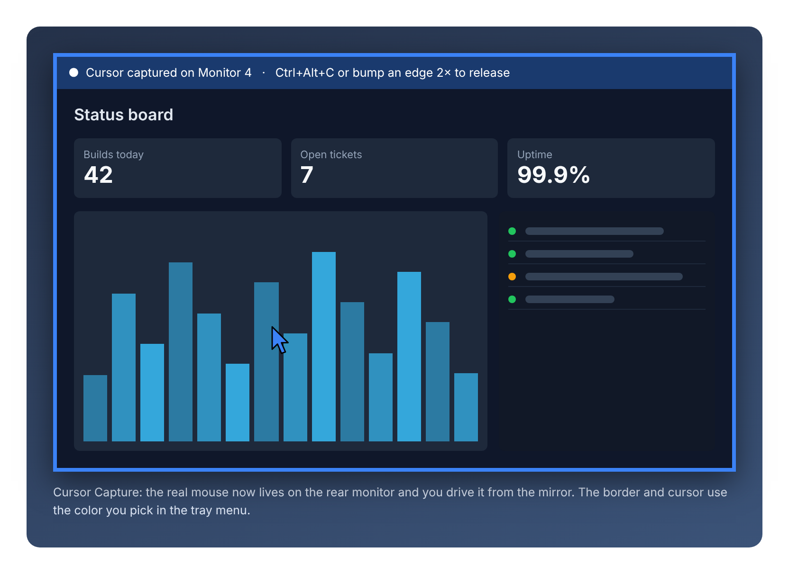
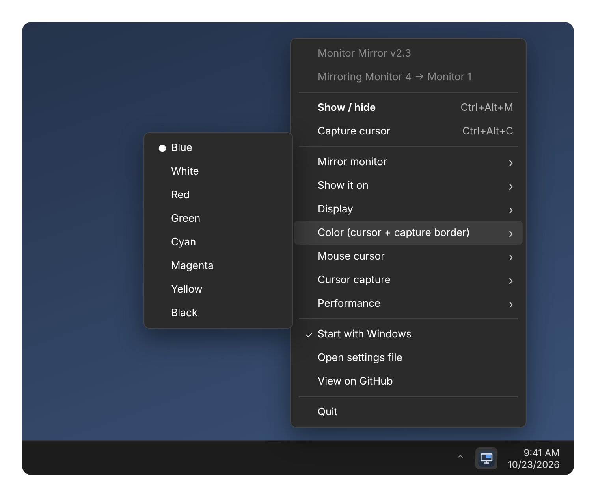

# Monitor Mirror

A Windows tray app that mirrors another monitor onto your main screen with a hotkey, so you can see the screen behind you without turning around.



<sub>Images in this README are illustrations, not screenshots.</sub>

## Features

- **Hotkey mirror.** Show a live copy of another monitor full-screen or picture-in-picture.
- **Live cursor.** Renders the real Windows cursor shape (arrow, I-beam, etc.) with optional color tinting.
- **Picture-in-picture.** Drag to move, scroll to resize.
- **Cursor Capture.** Control the real mouse on the mirrored monitor directly from the mirror. Release with a hotkey or by bumping a screen edge.
- **GPU capture.** Uses Desktop Duplication (dxcam) for smooth frame rates, with automatic GDI fallback.
- **Tray menu** for all settings, plus a *Start with Windows* toggle.
- **Auto-update takeover.** Starting a newer version closes the older running copy.



## Hotkeys

| Hotkey | Action |
| --- | --- |
| `Ctrl+Alt+M` | Toggle the mirror on/off |
| `Ctrl+Alt+C` | Toggle Cursor Capture |
| `Esc` / click | Hide the mirror |

Left-click the tray icon to toggle the mirror; right-click for settings.



## Setup

Requires Windows 10/11 and Python 3.10+.

```powershell
pip install -r requirements.txt
```

Then double-click `mirror.pyw`. The `.pyw` extension runs it without a console window.

**Tip:** Run it from your cloned repo folder (e.g. `C:\Dev\MonitorMirror`) before turning on *Start with Windows*. The startup entry points at the file's exact path, and updating is then just a `git pull`.

## Data

Settings are stored in `%APPDATA%\MonitorMirror\settings.json`.

## License

GPL-3.0. See [LICENSE](LICENSE).
